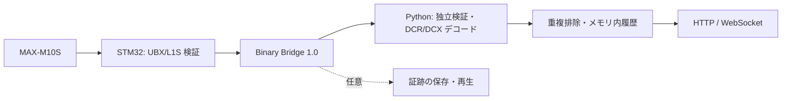

# HoshiGuard

HoshiGuard は、STM32 と u-blox MAX-M10S で QZSS L1S の災害・危機管理通報を受信し、
Linux ホストで DCR/DCX をデコードして HTTP/WebSocket JSON API として配信するシステムです。



シリアル受信は単一スレッド、ネットワーク配信は同一プロセスの独立したイベントループで動作します。
MCU のキューとホストの履歴には上限があり、データベースやメッセージブローカーは不要です。

## ハードウェアとファームウェア

構成例は STM32F103C8、MAX-M10S、QZSS L1S 対応アンテナ、USB-UART です。
信号は 3.3 V TTL とし、GND を共通に接続してください。電源条件は各モジュールの仕様に従ってください。

| STM32 | 接続先 |
|---|---|
| PA3 / USART2 RX | MAX-M10S TX |
| PA2 / USART2 TX | MAX-M10S RX |
| PA8 | MAX-M10S TIMEPULSE/PPS |
| PA9 / USART1 TX | USB-UART RX（Bridge 出力） |
| PA10 / USART1 RX | USB-UART TX |

[PlatformIO](https://docs.platformio.org/en/latest/core/installation/index.html) を導入してビルドします。

```sh
pio run -e genericSTM32F103C8-bridge-binary
# ST-Link を接続して書き込む場合
pio run -e genericSTM32F103C8-bridge-binary -t upload
```

既定環境は `bridge-binary` です。その他の環境と受信診断は[運用ガイド](docs/deployment.md)を参照してください。

## インストールと起動

Python 3.10 以降とシリアルデバイスの読み書き権限が必要です。Debian では通常 `dialout` グループを使います。

```sh
git clone https://github.com/TenkyuChimata/HoshiGuard.git
cd HoshiGuard
python3 -m venv .venv
. .venv/bin/activate
pip install './python[api]'
hoshiguard --port /dev/hoshiguard --api
```

既定の待ち受け先は `127.0.0.1:8000` です。長期運用、証跡の保存、TLS は[デプロイ手順](docs/deployment.md)を参照してください。
ハードウェアを接続せず、同梱の実受信データを再生することもできます。

```sh
hoshiguard --replay test/fixtures/bridge_real_session/selected_records.hgraw --api
# API を有効にしない場合は PublicAlert NDJSON を標準出力へ出力
hoshiguard --replay test/fixtures/bridge_real_session/selected_records.hgraw
hoshiguard --help
```

## HTTP / WebSocket API

| メソッド・パス | 内容 |
|---|---|
| `GET /api/v1/alerts/latest` | 最新の通報。該当なしは `data: null` |
| `GET /api/v1/alerts` | 新しい順の履歴。フィルター・ページングに対応 |
| `GET /api/v1/alerts/{id}` | キャッシュ内の指定通報。該当なしは 404 |
| `GET /api/v1/status` | 受信・デコード・サービスの状態 |
| `WS /api/v1/ws` | 初回の `snapshot` と以後の `alert` / `status` |

```sh
curl http://127.0.0.1:8000/api/v1/alerts/latest
curl 'http://127.0.0.1:8000/api/v1/alerts?service=DCR&limit=10'
curl 'http://127.0.0.1:8000/api/v1/alerts?status=test'
```

WebSocket は `ws://127.0.0.1:8000/api/v1/ws` に接続します。HTTP/WS とも既定では正式情報のみを返し、
訓練・試験情報は `status=test`、全件は `status=all` で指定します。同じ意味の反復放送は再通知しません。
履歴は既定で最大 512 件・24 時間のメモリ内保存です。再起動すると失われます。

公開形式は `hoshiguard.public-alert.v1` です。`id` は通報内容の識別子であり、災害イベントの一意な ID ではありません。
欠測値をゼロで補わず、DCR の推定年、DCX の相対時刻、不完全なデコードを区別します。
詳細は [API・データ形式](docs/api.md)、[JSON Schema](docs/public-alert.v1.schema.json)、
[実受信の DCR 例](docs/public-alert-real-marine.json)を参照してください。

## 仕様・検証・利用上の注意

- [プロトコル・対応範囲・公式仕様](docs/protocol.md)
- [テスト手順・実受信データの出所](test/fixtures/README.md)

本ソフトウェアは非公式の補助受信システムです。公式の災害情報や生命安全に関わるシステムを代替しません。
放送の欠落・遅延・誤りに備え、公式情報源と冗長な受信手段を確保してください。
重複排除は災害の同一性や終息を保証せず、メモリ内履歴は完全な災害記録ではありません。

本体は [GPL-3.0](LICENSE) です。同梱する azarashi の意味解析コードは、元の [MIT ライセンス](python/hoshiguard/_vendor/azarashi/LICENSE)と出所表示を保持しています。
