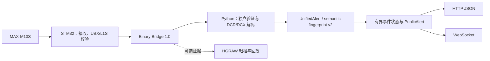

# HoshiGuard

HoshiGuard 是基于 **STM32 + MAX-M10S** 的 QZSS L1S 灾害与危机管理通报接收、
解码和实时 JSON 发布系统。适合在 Linux 小型主机中长期运行。



STM32 使用固定容量队列和非阻塞串口转发；Python 只由一个线程读取串口。
HTTP/WS 在同一进程的独立事件循环中运行，网络发送不在接收线程中执行。
不需要 Redis、数据库或消息代理。Bridge 1.0 协议保持不变。

## 硬件与固件

参考平台：STM32F103C8、MAX-M10S、QZSS L1S 天线、USB-UART。
使用 3.3V TTL 并共地；供电按各模块要求配置。

| STM32 | 连接 |
|---|---|
| PA3 / USART2 RX | MAX-M10S TX |
| PA2 / USART2 TX | MAX-M10S RX |
| PA8 | MAX-M10S TIMEPULSE/PPS |
| PA9 / USART1 TX | USB-UART RX，Bridge 输出 |
| PA10 / USART1 RX | USB-UART TX |

```sh
pio run -e genericSTM32F103C8-bridge-binary
# 接好 ST-Link 后按需烧录：pio run -e genericSTM32F103C8-bridge-binary -t upload
```

默认 PlatformIO 环境现为 Bridge Binary。文本诊断、回环和 MCU 独立显示环境仍可
显式选择，参见 [接收诊断归档](docs/receiver_diagnostics.md)。固件不会把 SLAS、
Null 或保留 MT 当成灾害业务消息。

## 安装与启动

```sh
python3 -m venv .venv
. .venv/bin/activate
pip install './python[api]'
hoshiguard --port /dev/hoshiguard --api
```

需要 Python 3.10+，串口用户需要设备读写权限，Debian 通常使用 `dialout` 组。
默认监听 `127.0.0.1:8000`；显式使用 `--api-host 0.0.0.0` 才对外监听。

```sh
# 可选：保存经过 Bridge CRC 验证的原始证据
hoshiguard --port /dev/hoshiguard --api --raw-archive captures/station.hgraw
# 回放：EOF 后 API 继续可读，所有数据明确标为历史
hoshiguard --replay test/fixtures/bridge_real_session/selected_records.hgraw --api
# 不启用 API 时，将去重后的 PublicAlert NDJSON 输出到 stdout
hoshiguard --replay captures/station.hgraw
hoshiguard --help
```

主入口只保留接收、回放、API、证据归档和必要限额。旧 observation、Human、
NDJSON session、health 文件与审计参数放到 `hoshiguard diagnose --help`，
相关分析脚本保留在 `tools/`，不随 API 常驻。

## HTTP JSON API

| 方法与路径 | 用途 |
|---|---|
| `GET /api/v1/alerts/latest` | 最新正式业务通报；没有数据时 `data: null` |
| `GET /api/v1/alerts` | 有界历史；支持 service/category/status/limit/offset/view |
| `GET /api/v1/alerts/{id}` | 读取仍在缓存中的语义消息；不存在时 404 |
| `GET /api/v1/status` | 接收、解码、历史数据与服务健康状态 |

```sh
curl http://127.0.0.1:8000/api/v1/alerts/latest
curl 'http://127.0.0.1:8000/api/v1/alerts?service=DCR&limit=10'
curl 'http://127.0.0.1:8000/api/v1/alerts?status=test'
```

默认只返回 `actual`，训练/测试通过 `status=test` 查询，`status=all` 显式获取全部。
响应为 `application/json` 和 `Cache-Control: no-store`；所有查询直接读内存。
默认保存最多 512 条、24 小时历史，可用 `--history-limit` 调整数量。
不同灾害的通报并行保留，不会全部覆盖成一个全局对象。

## WebSocket

连接 `ws://127.0.0.1:8000/api/v1/ws`，默认只推送正式信息。
训练通道使用 `/api/v1/ws?status=test`，全部使用 `?status=all`。

连接后收到 `snapshot`，以后只有新业务提交才收到 `alert`；接收链路改变时收到
`status`。`type` 是传输消息类型，灾害类别位于 `data.category`。
同一语义的卫星重复广播不重复推送。支持协议级 ping/pong；无需应用层心跳 JSON。

每个连接最多排队 32 条，共最多 64 个客户端。队列溢出关闭码 1013；客户端应退避
重连并以新快照替换本地视图。`process_id` 改变意味着服务已重启；`sequence` 仅在
该进程内递增，不能作为灾害 ID 或跨重启恢复游标。

## 数据模型

公开格式为 `hoshiguard.public-alert.v1`，是内部 `hoshiguard.alert.v1` 的投影。
保留类别和原始代码、正式/测试状态、发布/更新/取消/解除行为、时间、区域、严重程度、
类别特有 payload、解码有效性和出处。默认不输出完整 UBX、L1S、PPS 或内部路径。

`id=sf2-<semantic_fingerprint>` 标识语义消息内容，不是全球唯一灾害事件。
`identity.event_id=null`；有限可信度的 `correlation_hint` 不用于强制合并灾害。
DCR 的年份来自接收上下文推算并明确标注；UTC 用 `+00:00`，JST 为 UTC+9。
DCX 的相对周/分钟保留原值，当前公开层不推算绝对发生时间。
缺失的震级、深度、震源和震度不会填零；QZSS 数据不是 JMA XML 原文。

详见 [API 与恢复约定](docs/api.md)、[JSON Schema](docs/schema/public-alert.v1.schema.json)、
[真实 HGRAW 解码示例](docs/examples/public-alert-real-marine.json)。

## 运行状态与部署

`disconnected`：串口断开；`waiting_hello`：等待合法握手；`stalled`：串口已打开但
15 秒无 Bridge 帧；`no_l1s`：Bridge 有通信但 30 秒无有效 L1S。正常没有灾害新报
不会造成故障状态。断线、重放和接收停滞时 `data_mode=historical`，即使缓存仍有内容。

使用 [systemd 部署指南](docs/systemd_deployment.md) 和
[Nginx 配置](packaging/nginx/hoshiguard.conf.example) 管理长期运行、TLS、限速与 WS Upgrade。
默认不保存业务日志或证据文件；开启归档时须安排磁盘保留期。

## 测试、规范与限制

```sh
pip install './python[test]'
python3 -m unittest discover -s python/tests -v
python3 -m unittest discover -s tools/tests -v
sh tools/run_native_sanitizers.sh
```

网络测试需要允许 loopback socket。DCR 使用 017 的新增时间/代码定义并保留旧广播值；
具体差异见 [DCR-017 审计](docs/dcr017_audit.md)。DCX 依据 DCX-004 / CAMF 1.2。
EX11 的国家专有语义仍不解读；市町村名称是未独立核验为现行权威版本的快照。
[支持矩阵](docs/support_matrix.md) 区分已实现、合成验证和真实广播证据，不能视为
所有类别都经过真实卫星验证。

本软件为非官方辅助接收系统，不替代官方灾害信息和生命安全系统。广播可能缺失、
延迟或错误，使用者应安排官方信息源和冗余。缓存不持久化，内存历史不是完整灾害档案，
消息去重也不表示已证明事件关联或结束。

[本次中文架构审计与测试报告](docs/architecture_audit_20261030.md) 列明实际修改、
验证数量、可复现测量及尚未验证的硬件/长时间运行项目。仓库遵循 GPL-3.0，vendored
azarashi 语义核心保留原 MIT 许可与出处。
